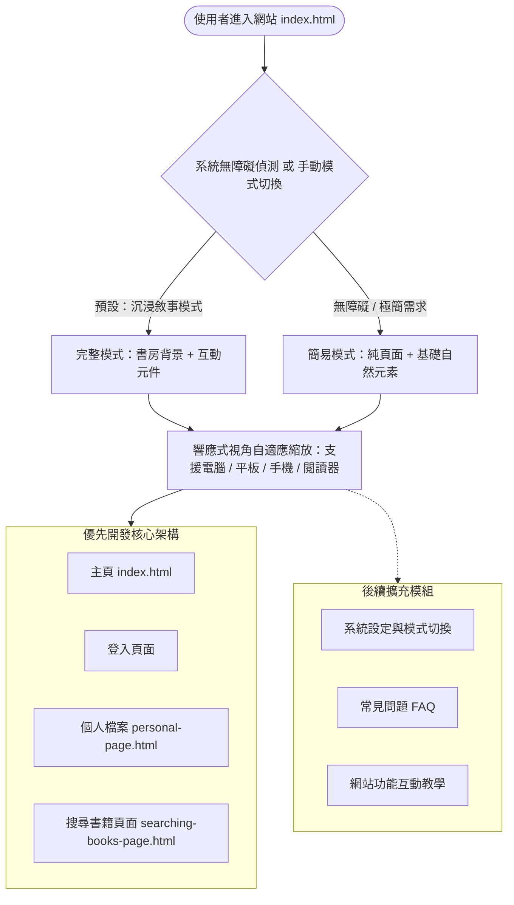

# Sylvan Folios Library（精靈的個人書房）

結合「世界樹、奇幻圖書館與精靈敘事」的沉浸式個人書目管理與閱讀平台。

## 1. 現行系統架構與頁面邏輯 (Current Architecture)

---

## 2. 設計緣起與核心決策 (Design Evolution)

### 痛點與概念發想
* **改善傳統閱讀體驗**：在使用 HyRead 等傳統電子書平台時，發現頁面頻繁跳轉容易造成操作中斷與認知負擔，因此構思一套更流暢、直覺的理想圖書館架構。
* **空間敘事與自然元素**：靈感源自室內木質家具與自然植栽的溫潤氛圍，定調以「木與草」為視覺基調，並引入**世界樹、圖書館與精靈**作為敘事包裝，讓瀏覽書庫具備空間探索感。

### 關鍵設計決策 (Architectural Decisions)
1. **雙模式介面切換（沉浸敘事 vs. 無障礙簡易模式）**
   * **主要模式（背景 + 互動元件）**：保留完整的世界樹與奇幻書房視覺敘事，提供高度沉浸感。
   * **切換模式（純頁面 + 自然元素）**：考量螢幕閱讀器使用者、無障礙需求（Accessibility）及偏好極簡畫面的族群，偵測系統無障礙設定或經由使用者手動切換時，自動降級為低資源損耗、低認知負荷的純淨版面。
2. **跨裝置響應式策略（等比例視角縮放 vs. 大版面滑動）**
   * 針對手機、平板與電子書閱讀器（E-Reader）等較窄視角，放棄「大版面自由滑動」（避免在螢幕尺寸過小、版面過大的情況下滑動半天找不到目標，或因遺漏功能而降低瀏覽意願），最終選定**「隨螢幕尺寸自適應縮放（Responsive Scaling）」**，確保使用者在任何裝置上都能一眼掌握完整功能配置。

---

## 3. 架構演進與決策對照表 (Architecture Decision Records)

| 設計面向 | 早期構想 (v1.0 Initial) | 現行修正邏輯 (v2.0 Current) | 修正原因與考量 |
| :--- | :--- | :--- | :--- |
| **視覺與敘事** | 純背景圖 + 滿版互動元件 | 保留「沉浸模式」，新增「無障礙簡易模式」切換 | 降低螢幕閱讀器與極簡需求者的認知負荷與裝置資源損耗 |
| **跨裝置排版** | 大版面自由滑動探索 | 隨螢幕尺寸自適應等比例縮放 (Responsive Scaling) | 避免在手機、平板或閱讀器上因視角過窄而滑動迷航或遺漏功能 |
| **開發優先級** | 一次規劃 7 個完整功能頁面 | 優先實作核心 4 頁（主頁、登入、個人檔案、搜尋） | 確保核心書庫與閱讀動線先穩定運作，設定與教學列為第二階段 |
| **資產與部署** | 本機靜態檔案讀取（`homepage.html` + 本機圖片） | GitHub Pages（`index.html`）+ Supabase Storage | 解決本機大圖無法隨 Git 輕量化同步，並實現跨裝置（平板）隨時展示 |

---

## 4. 功能模組細部邏輯 (Module Details)

*(預留擴充區：後續將逐步補上登入驗證、搜尋書籍篩選、個人書架分類與 Supabase 資料庫串接之細部流程)*
