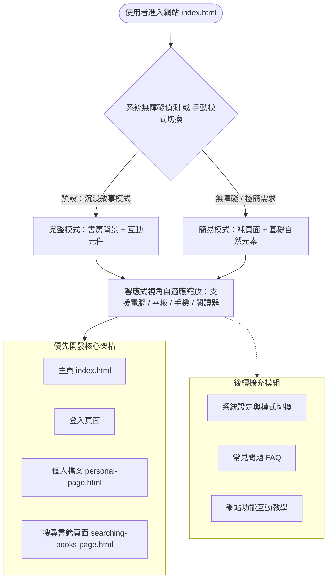
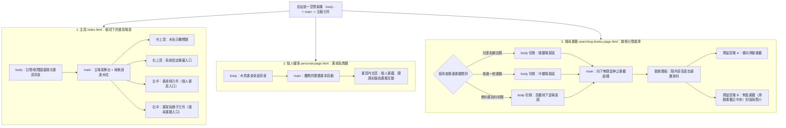
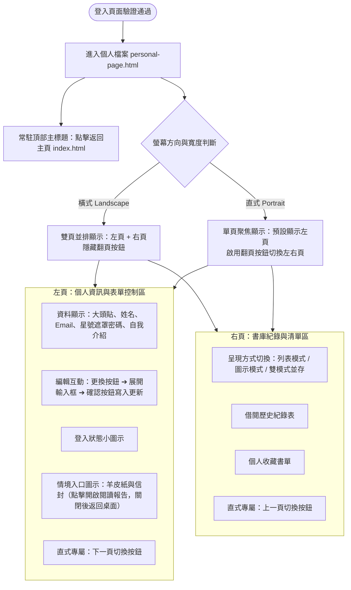
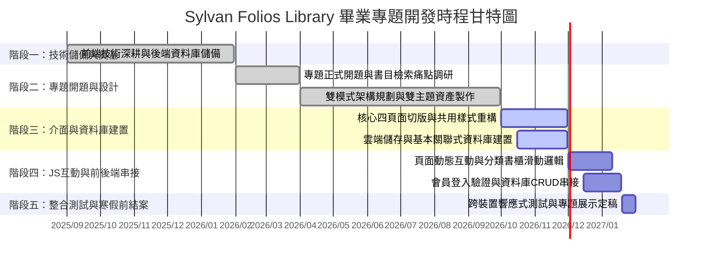

# Sylvan Folios Library（精靈的個人書房）

> **畢業專題作品（Graduation Project）** — 結合「世界樹、奇幻圖書館與精靈敘事」的沉浸式個人書目管理與閱讀平台。

## 1. 現行系統架構與頁面邏輯 (Current Architecture)

---

## 2. 設計緣起與核心決策 (Design Evolution)

### 痛點與概念發想
* **改善傳統書目檢索體驗**：在使用傳統線上圖書館與電子書平台（如 HyRead）進行「找書與書單管理」時，發現多層級選單與頻繁的頁面跳轉容易造成操作中斷與認知負荷，因此構思一套將檢索、分類預覽與個人書單整合於直覺視覺動線中的**空間化使用者介面（Spatial UI）**。
* **空間敘事與自然元素**：靈感源自室內木質家具與自然植栽的溫潤氛圍，定調以「木與草」為視覺基調，並引入了**世界樹、圖書館與精靈**作為**空間敘事（Spatial Narrative）**包裝，讓瀏覽書庫更具備空間探索感。

### 關鍵設計決策 (Architectural Decisions)
1. **雙模式介面切換（沉浸敘事 vs. 無障礙簡易模式）**
   * **主要模式（背景 + 互動元件）**：保留完整的世界樹與奇幻書房視覺敘事，提供高度沉浸感。
   * **切換模式（純頁面 + 自然元素）**：考量螢幕閱讀器使用者、無障礙需求（Accessibility）及偏好極簡畫面的族群，偵測系統無障礙設定或經由使用者手動切換時，自動降級為低資源損耗、低認知負荷的純淨版面。
2. **跨裝置響應式策略（等比例視角縮放 vs. 大版面滑動）**
   * 針對手機、平板與電子書閱讀器（E-Reader）等較窄視角，放棄「大版面自由滑動」（避免在螢幕尺寸過小、版面過大的情形下滑動半天找不到目標，或因遺漏功能而降低瀏覽意願），最終選定**「隨螢幕尺寸自適應縮放（Responsive Scaling）」**，確保使用者在任何裝置上都能一眼掌握完整功能配置。

---

## 3. 架構演進與決策對照表 (Architecture Decision Records)

| 設計面向 | 早期構想 (v1.0 Initial) | 現行修正邏輯 (v2.0 Current) | 修正原因與考量 |
| :--- | :--- | :--- | :--- |
| **視覺與敘事** | 純背景圖 + 滿版互動元件 | 保留「沉浸模式」，新增「無障礙簡易模式」切換 | 降低螢幕閱讀器與極簡需求者的認知負荷與裝置資源損耗 |
| **跨裝置排版** | 大版面自由滑動探索 | 隨螢幕尺寸自適應等比例縮放 (Responsive Scaling) | 避免在手機、平板或閱讀器上因視角過窄而滑動迷航或遺漏功能 |
| **開發優先級** | 一次規劃 7 個完整功能頁面 | 優先實作核心 4 頁（主頁、登入、個人檔案、搜尋） | 確保核心書庫與閱讀動線先穩定運作，設定與教學列為第二階段 |
| **資產與部署** | 本機靜態檔案讀取（`homepage.html` + 本機圖片） | GitHub Pages（`index.html`）+ Supabase Storage | 解決本機大圖無法隨 Git 輕量化同步，並實現跨裝置隨時展示與雲端管理 |

---

## 4. 功能模組與空間架構細部邏輯 (Module Details)

### 4.1 靜態資源與主題管理 (Asset & Theme Management)
* **雙時段主題架構（Daytime / Evening）**：全站視覺資源皆配置日間（淺色暖陽）與夜間（深色月光）兩組獨立圖檔，並統一轉為 `.webp` 格式以優化載入效能。
* **雲端儲存結構**：所有靜態圖檔統一放置於 Supabase Storage 的公開儲存桶 `site-assets` 中，並依照頁面模組劃分目錄：
  * `index-img/`：主頁場景背景、房間過渡木柱與互動場景元件。
  * `personal-page-img/`：木質桌面背景與攤開的書本主體容器。
  * `searching-books-page-img/`：依書籍分類動態切換之三種書櫃場景背景與層板元件。

### 4.2 核心頁面 DOM 階層與空間佈局邏輯 (Spatial DOM Architecture)
全站三大核心頁面皆遵循統一的 **`body（環境背景層） ➔ main（主舞台容器） ➔ 內部互動元件`** 三層式空間架構，確保跨裝置縮放時的比例一致性：

| 頁面模組 | `body`（環境背景層） | `main`（主舞台容器） | 內部互動與排版邏輯 |
| :--- | :--- | :--- | :--- |
| **主頁 (`index.html`)** | 圓窗樹冠陽光／月光書房大景 | 中央場景舞台，兩側配置木柱強化室內空間過渡感 | 四大空間錨點：中上木告示欄（標題）、右上藤蔓（設定）、左中書桌椅（個人頁）、右中書架梯子（搜尋頁） |
| **個人檔案 (`personal-page.html`)** | 溫潤木質書桌桌面背景 | 一本攤開的書本主體容器 | 所有個人書架與閱讀筆記皆收斂於左右書頁版面內呈現 |
| **搜尋書籍 (`searching-books-page.html`)** | 隨篩選分類動態切換（矮櫃／中櫃／高櫃地下室） | 固定以書櫃櫃體外觀呈現，支援向下無限延伸 | 內部透過動態層板承載內容，劃分「滑動書櫃區」與「中央焦點書籍封面／介紹區」兩大核心互動區塊 |

### 4.3 個人檔案頁面 (`personal-page.html`) 細部邏輯

#### 1. 頁面定位與全域導覽
* **身分驗證入口**：作為使用者登入系統（Login）後的主要進入頁面與個人中心。
* **常駐返回錨點**：網頁主標題（Title）常駐於所有主要內容正上方，點擊主標題即可直接導航返回主頁（`index.html`）。

#### 2. 跨螢幕方向與書頁響應式邏輯 (Landscape vs. Portrait)
頁面主體以「木質桌面（`body`）上的攤開書本（`main`）」為核心隱喻，並依據裝置螢幕方向動態調整書頁呈現與翻頁控制項：
* **橫式模式（Landscape / 預設寬螢幕）**：同時完整攤開「左頁」與「右頁」，因雙頁並排顯示，**隱藏**「下一頁／上一頁」翻頁按鈕。
* **直式模式（Portrait / 窄螢幕縮放）**：因視角寬度受限，單次僅顯示「單一書頁」（預設顯示左頁），並**動態顯示**翻頁控制項：
  * 位於**左頁**時：顯示「下一頁（切換至右頁）」按鈕。
  * 位於**右頁**時：顯示「上一頁（返回左頁）」按鈕。

| 書頁區域 | 核心屬性 | 包含元件與互動邏輯 |
| :--- | :--- | :--- |
| **左頁 (Left Page)** | **個人資料顯示 + 修改表單類** | • **基本欄位**：大頭貼、姓名、電子郵件、星號遮罩（`****`）密碼、自我介紹。 • **編輯機制**：各欄位對應更換按鈕，點擊觸發輸入框並透過確認按鈕送出更新。 • **情境圖示**：登入狀態小圖示；「羊皮紙與信封」小圖示（模擬從桌面拿起信函閱讀報告，閱畢放下返回桌面）。 • **導覽控制**：直式單頁模式下顯示「下一頁」按鈕。 |
| **右頁 (Right Page)** | **書庫數據 + 表格與清單類** | • **紀錄檢視**：借閱歷史（History）、個人收藏（Favorites）。 • **檢視切換**：支援「純列表（List）」、「純圖示（Grid/Icon）」與「列表＋圖示雙重呈現」三種版面切換。 • **導覽控制**：直式單頁模式下顯示「上一頁」按鈕。 |

---

## 5. 專案開發時程規劃 (Project Timeline)

| 開發階段 | 時間區間 | 核心交付目標 | 目前狀態 |
| :--- | :--- | :--- | :--- |
| **階段一：技術儲備與奠基** | `2025/09 – 2026/01` | 確立以前端 (Frontend) 為核心基準，同步自主儲備後端 (Backend) 與關聯式資料庫 (Relational Database) 基礎實作能力 | 已完成 |
| **階段二：專題開題與設計** | `2026/02 – 2026/09` | **2026/02–03 正式開題**，完成傳統書目檢索痛點調研與世界樹空間敘事 (Spatial Narrative) 定調；接續完成雙模式與響應式網頁設計 (Responsive Web Design, RWD) 架構規劃及日夜間 `.webp` 資產製作（**2026/09 開學正式進入專題製作課程**） | 已完成 |
| **階段三：介面與資料庫建置** | `2026/10 – 2026/11` | 核心四頁面結構切版、抽出共用樣式表 (`theme.css`)、雲端儲存空間 (Cloud Storage) 與基本資料表 (Database Tables) 架設 | **進行中** |
| **階段四：互動邏輯與資料串接** | `2026/12 – 2027/01 中旬` | 動態網頁腳本 (JavaScript, JS) 互動實作（分類書櫃切換、滑動書櫃焦點判定、左右書頁翻頁）、會員驗證與增刪查改 (Create, Read, Update, Delete, CRUD) 串接 | 規劃中 |
| **階段五：整合測試與寒假前結案** | `2027/01 下旬` | 跨裝置相容性與無障礙功能 (Accessibility) 完整測試、系統效能優化與畢業專題 (Graduation Project) 寒假前最終展示定稿 | 規劃中 |
